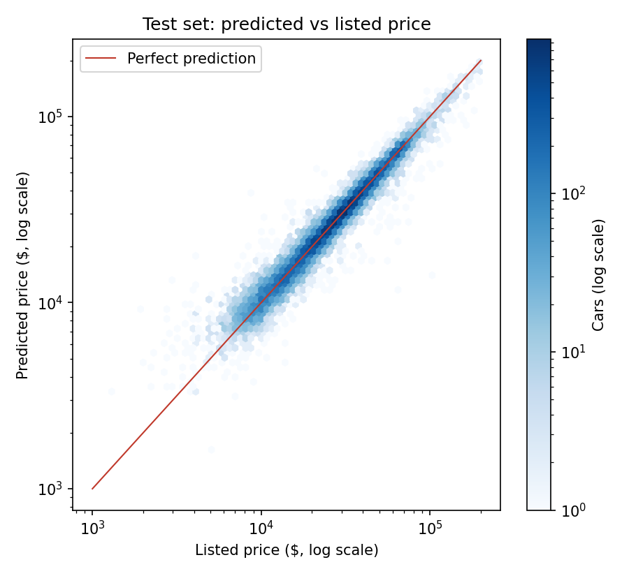
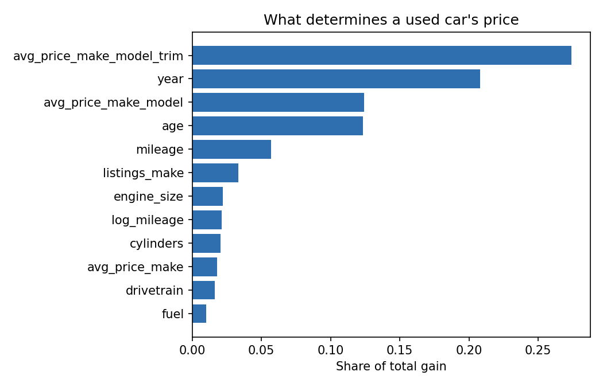
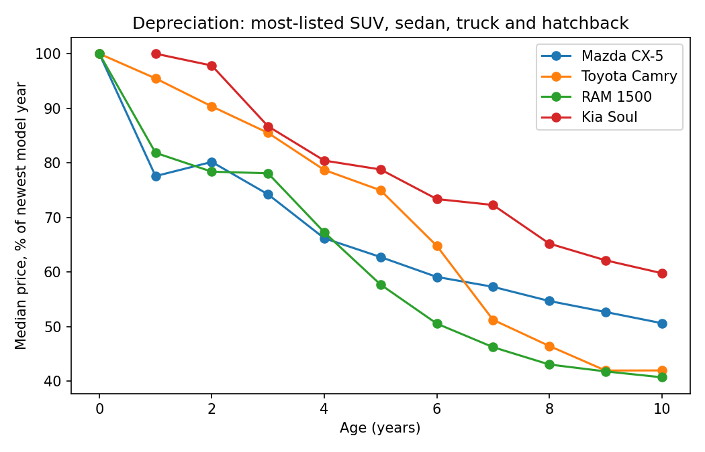

# Used Car Price Prediction

> Machine Learning coursework, The British University in Egypt, 2025, rebuilt and retrained. Author: Ziad Ayman.

Predicting the price of a used car from its listing: make, model, trim, year, mileage and the messy free-text engine, transmission and colour fields. Trained on **413,083 real cars.com listings** on the GPU, it estimates a car's price with a **median error of 4.7%** and explains **96.6%** of the variation in price.

## Results (41,309 test cars never seen in training)

| Model | R² (log price) | R² (dollars) | Mean absolute error | Median error | Within 10% |
|---|---|---|---|---|---|
| Median price of the same make, model and year | 0.881 | 0.881 | $3,513 | 8.6% | 55.9% |
| Ridge regression (one-hot) | 0.938 | 0.931 | $2,596 | 6.6% | 67.7% |
| **XGBoost (GPU, target-encoded models)** | **0.964** | **0.966** | **$1,843** | **4.7%** | **79.4%** |

The first row is the "look it up in a price guide" baseline; XGBoost halves its error. Training takes **36 seconds on an RTX 3060** (2,919 trees chosen by early stopping on a validation set).



| Price band | Test cars | Median error |
|---|---|---|
| Under $10,000 | 2,161 | 11.2% |
| $10,000–19,999 | 9,738 | 6.4% |
| $20,000–29,999 | 12,332 | 4.3% |
| $30,000–49,999 | 12,524 | 4.0% |
| $50,000–79,999 | 4,125 | 3.7% |
| $80,000 and above | 429 | 6.7% |

Cheap cars are hardest: at that age, condition and accident history (which the listings do not include) matter more than the specification.

## What the model learned


The trim-level average price, model year, model average and mileage carry most of the information. Engine size, cylinders and drivetrain refine it.



## Deal finder
Listings priced far below what the model expects for the same car are either bargains or have a problem the data does not show (salvage title, accident damage), so they are worth a closer look. For example, from the test set:

| Car | Year | Mileage | Listed | Model estimate |
|---|---|---|---|---|
| Ford Transit-350 XLT | 2020 | 10,000 | $8,999 | $39,050 |
| Nissan Pathfinder SL | 2024 | 48,964 | $10,479 | $29,830 |
| Chevrolet Equinox 1LT | 2024 | 25,469 | $9,900 | $24,860 |

Only models with at least 50 training listings are judged, because estimates for rare cars (a 1999 Plymouth Prowler) are unreliable.

## Feature engineering
Carried over from the original coursework and rewritten as tested functions in `carprice/parsing.py`:
- **Engine text** (`"Pentastar 3.6L V-6 DOHC"`, `"2.0L I4 16V GDI DOHC Turbo"`) → engine size, cylinders, turbo or supercharger flag.
- **Transmission** → type (Automatic, CVT, Dual-Clutch, Manual) and number of gears.
- **Colours**: hundreds of marketing names (`"Granite Crystal Metallic Clearcoat"`) → 13 base colours plus the finish (solid, metallic, pearl, matte).
- **Fuel economy** `"19-26"` → city and highway mpg; fuel type and drivetrain spellings normalised.
- **Age and usage**: age at the October 2026 snapshot, miles per year.
- **Make, model and trim** (1,300+ models, 6,500+ trims): **out-of-fold target encoding**. Each name is replaced by its average log price, computed with 5-fold cross-fitting so no car is encoded using its own price, plus how many listings the average is based on.

## Cleaning
| Step | Rows |
|---|---|
| All listings (new and used) | 1,614,161 |
| Used cars with full specifications | 418,997 |
| One row per vehicle (duplicate VINs removed, latest kept) | 416,665 |
| Price $1,000–200,000, year 1990–2027, mileage 1–400,000 | **413,083** |

## Run it
```bash
pip install -r requirements.txt
# download usa_used_cars_carscom_1_6m.parquet into data/ (link below)
python -m carprice train            # about 1 minute with a GPU; writes results/ and models/
python -m carprice predict --make Toyota --model Camry --trim SE --year 2021 --mileage 40000
# Estimated price: $23,178
python -m pytest -q                 # 27 tests
```

## Project structure
```
carprice/
├── parsing.py   # engine, transmission, colour, fuel, drivetrain and mpg parsers
├── data.py      # cleaning rules, deduplication, feature table
├── model.py     # baselines, target-encoded XGBoost, metrics, save/load, deal finder
└── __main__.py  # train and predict commands, figures, results/results.json
tests/           # every parser, cleaning rules, fallbacks, save/load, end-to-end command line
notebooks/       # the original coursework notebook
```

## About the data and the original version
The original coursework used a class dataset of 19,109 listings (`train.csv` / `test.csv`) that is no longer available, so this version is retrained on a larger, newer dataset from the same source: [cars.com used-car listings, October 2026](https://huggingface.co/datasets/KTHESAT/usa-used-car-market-cars-com) (CC BY 4.0), not included in this repository. The scores are therefore not directly comparable with the original (R² 0.900 on log price with tuned XGBoost).

The original notebook (kept in `notebooks/`) had two bugs found in review, both fixed here:
- the target-encoded brand and model columns were then scaled in a way that made them constant, so the two strongest predictors were unused;
- outlier capping turned binary flags into constants.

## Tech stack
Python · pandas · scikit-learn · XGBoost (CUDA) · NumPy · matplotlib · pytest
